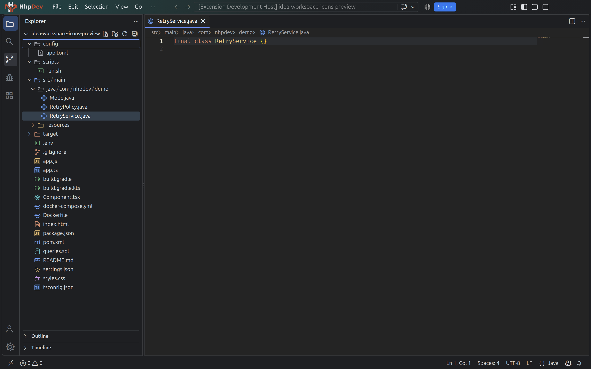

<div align="center">
  
  <h1>IDEA-inspired Workspace</h1>
  <p>An IntelliJ-inspired appearance for Visual Studio Code that keeps native VS Code workflows intact.</p>
  <p><strong>Created by NhpDev</strong></p>
  <p>
    <a href="https://github.com/nhpo1995/vscodeIDEA/releases/latest"></a>
    <a href="LICENSE"></a>
    
    <a href="https://github.com/nhpo1995/vscodeIDEA/releases"></a>
    <a href="https://github.com/nhpo1995/vscodeIDEA/stargazers"></a>
    <a href="https://github.com/nhpo1995/vscodeIDEA/issues"></a>
  </p>
  <p>
    <a href="https://github.com/nhpo1995/vscodeIDEA/releases">Download a release</a>
    ·
    <a href="CHANGELOG.md">Changelog</a>
    ·
    <a href="LICENSE">MIT License</a>
  </p>
</div>



## Overview

IDEA-inspired Workspace brings a coordinated dark theme, file icons, product icons, Java semantic highlighting, and optional title-bar customization to Visual Studio Code. The extension keeps the native menus, panels, editor layout, and keyboard workflows.

This source tree contains version **0.6.0**. See [GitHub Releases](https://github.com/nhpo1995/vscodeIDEA/releases) for available releases and downloadable VSIX packages.

## Features

- **IDEA-inspired Dark theme** with a neutral editor background and coordinated syntax colors.
- **Coordinated terminal colors** with a complete 16-color ANSI palette, cursor and selections. Application log colors require ANSI output from the application; the theme controls the palette, not log-level detection.
- **Automatic editor and terminal typography** uses JetBrains Mono at 14px, with 1.2 terminal line spacing. The original font is bundled and installed for the current desktop user when missing; an existing Nerd Font variant is preferred in the terminal. Later user edits are preserved on upgrades.
- **File icon theme** with 38 SVG assets, mappings for common extensions and filenames, and distinct folder states.
- **Product icon theme** with 24 original glyphs for project and symbol views.
- **Java semantic highlighting** for types, methods, and readonly `UPPER_CASE` constants when a Java language server provides semantic tokens.
- **Optional title-bar logo and workbench styling** with Apply and Restore commands.
- **Logo selection** from a local SVG or PNG file.
- **Upgrade-safe settings** that preserve your later edits across automatic upgrades.
- **CSS recovery and reload status** with a native Reload Window action when the workbench needs to load updated styling.
- **Diagnostics and setup commands** to review the extension state.

## Installation

### Install from GitHub Releases

1. Open [Releases](https://github.com/nhpo1995/vscodeIDEA/releases) and choose a version.
2. Download that release's `idea-workspace-<version>.vsix` asset.
3. In VS Code, open the Command Palette and run **Extensions: Install from VSIX...**.
4. Select the downloaded VSIX file.

You can also install from a terminal:

```sh
code --install-extension ./idea-workspace-0.6.0.vsix
```

Replace the filename with the version you downloaded. After installation, the theme and icon themes apply automatically when the extension activates.

### Bundled font

On desktop, the extension installs the bundled, unmodified JetBrains Mono 2.304 Regular, Bold, Italic and Bold Italic fonts for the current user if that font family is not already available. Installation works offline and does not request administrator privileges. Linux requires fontconfig (`fc-match` and `fc-cache`). If installation is unavailable or blocked, the appearance settings use fallback fonts; retry with **IDEA Workspace: Install or Retry Font Setup**.

If the new font is not visible immediately, fully quit and reopen VS Code. Restore reverses extension-managed font settings and pauses automatic setup, but Restore and uninstall leave the installed font available to other applications. A separately installed Nerd Font is needed for all prompt icons; bundled JetBrains Mono is the original upstream font.

JetBrains Mono is licensed separately under SIL OFL 1.1. Its copyright and complete license are included in [OFL.txt](fonts/jetbrains-mono/OFL.txt); see [third-party notices](THIRD_PARTY_NOTICES.md).

## Optional workbench customization

VS Code does not expose an API for changing the application title-bar logo or injecting custom workbench CSS. The extension can patch the installed VS Code workbench to provide those optional appearance changes.

- On Linux installations that require administrator access, the extension requests authentication through the operating system's PolicyKit dialog (`pkexec`). It does not ask you to enter a password in the terminal or change installation permissions.
- Automatic elevation for this patch is implemented for Linux. On Windows and macOS, the theme and icon themes work, but equivalent automatic elevation for the workbench patch is not currently provided.
- After applying the workbench patch, choose **Reload Window** when prompted to load the updated CSS. You can also use **IDEA Workspace: Reload Window to Load UI** from the Command Palette.
- Cancelling authentication leaves the theme and icon themes available. Use **IDEA Workspace: Apply UI and Logo** to try the optional patch again.

### Restore changes

Run **IDEA Workspace: Restore UI and Settings** to remove the extension's marked CSS patch and restore the appearance settings it changed. Restore preserves unrelated CSS and settings edits, then prompts you to reload the window when needed. After Restore, automatic reapplication stays paused until you choose Apply again. Restore before uninstalling if you want to remove the workbench customization.

## Commands

Open the Command Palette and search for **IDEA Workspace**:

| Command | Purpose |
| --- | --- |
| `IDEA Workspace: Apply UI and Logo` | Reapply the extension presets for the theme, icons, UI colors, and logo. Use this to return to the extension's appearance settings. |
| `IDEA Workspace: Open Setup` | Open the setup menu. |
| `IDEA Workspace: Choose Logo (SVG or PNG)` | Choose a new logo; the extension applies it automatically. |
| `IDEA Workspace: Install or Retry Font Setup` | Retry installing bundled JetBrains Mono for the current user. |
| `IDEA Workspace: Reload Window to Load UI` | Reload VS Code after the workbench CSS changes. |
| `IDEA Workspace: Diagnose UI and Logo` | Inspect the current state and troubleshoot setup. |
| `IDEA Workspace: Restore UI and Settings` | Undo extension-managed changes while preserving your later edits. |

The `ideaWorkspace.logoPath` setting accepts an absolute path to a local SVG or PNG. Leave it empty to use the bundled NhpDev logo. The logo picker applies the selection automatically.

## Java highlighting

Java-specific semantic colors depend on an active Java language server and semantic highlighting. The extension reads semantic tokens from the existing provider and adds decorations for readonly uppercase constants; it does not replace the Java language server or infer constants from names alone. If semantic tokens are not available yet, the theme's regular colors are used until the provider updates.

The file icon theme classifies files by extension and filename. It does not inspect Java source to give Explorer icons based on whether a file contains a class, interface, or enum. Semantic symbol icons may appear in Outline when the language provider supplies the symbol kind.

## Compatibility and limitations

- Requires Visual Studio Code **1.95.0 or later**.
- Theme and icon themes use VS Code extension APIs. The optional workbench CSS and logo patch modifies files in the VS Code installation, is shared across profiles, and may trigger VS Code's installation-integrity warning.
- A VS Code update may replace the patched files. The extension attempts to reapply the patch once after an update; you can also use Apply to retry.
- Native title-bar behavior varies by operating system and title-bar mode. The extension does not change the taskbar icon or Activity Bar logo.
- The supplied icons are original assets inspired by the reference style; they are not a complete copy of IntelliJ icons.
- No telemetry is sent by this project.

## Build and test

Requirements: Node.js and npm. The runtime extension has no external runtime dependencies.

```sh
git clone https://github.com/nhpo1995/vscodeIDEA.git
cd vscodeIDEA
npm ci
npm test
npm run package
```

`npm test` compiles the TypeScript and runs the Node.js test files. `npm run package` compiles the extension and creates a VSIX package using `vsce`.

Optional asset builders:

- Rebuild file icon SVG assets with `python3 scripts/build-file-icons.py` (no third-party Python packages required).
- Rebuild the product icon font with `python3 scripts/build-product-icons.py` (requires Python and `fonttools` 4.60.1).

## Contributing

Bug reports, corrections, and focused pull requests are welcome. For larger changes, open an issue first to discuss the expected behavior. Include your VS Code version and reproduction steps when reporting a problem. Please keep changes scoped and avoid adding unrelated workbench modifications.

## Releases

See the [changelog](CHANGELOG.md) for project history and [GitHub Releases](https://github.com/nhpo1995/vscodeIDEA/releases) for tags and downloadable VSIX files.

## License

The extension code is licensed under the [MIT License](LICENSE). Bundled JetBrains Mono fonts retain their [SIL OFL 1.1 license](fonts/jetbrains-mono/OFL.txt).

## Upgrades and Restore

Automatic upgrades preserve settings you have changed or deleted, and later upgrades leave those choices alone. **Apply UI and Logo** intentionally reapplies the extension presets. **Restore UI and Settings** reverses extension-managed changes while preserving later edits. The extension also checks its custom CSS on activation and recovers it if an update or reinstall removes it. The status bar reports when the CSS needs a window reload; “CSS installed” confirms the file on disk, not that the renderer has loaded it.
